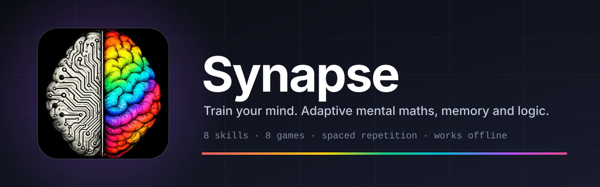
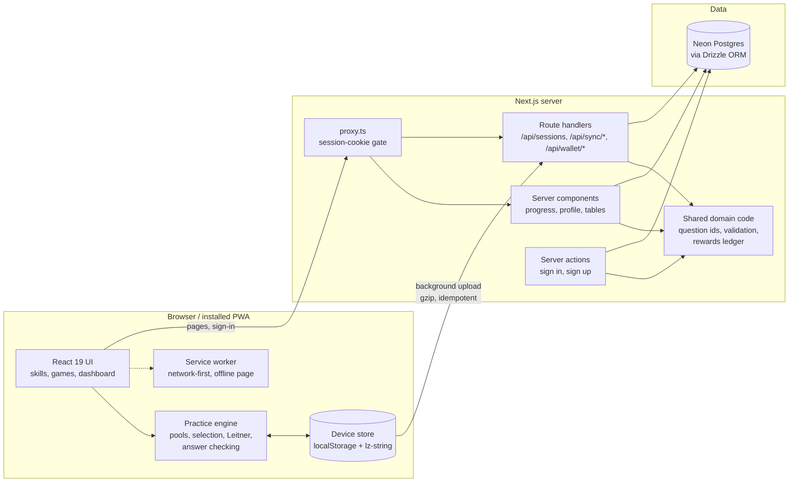
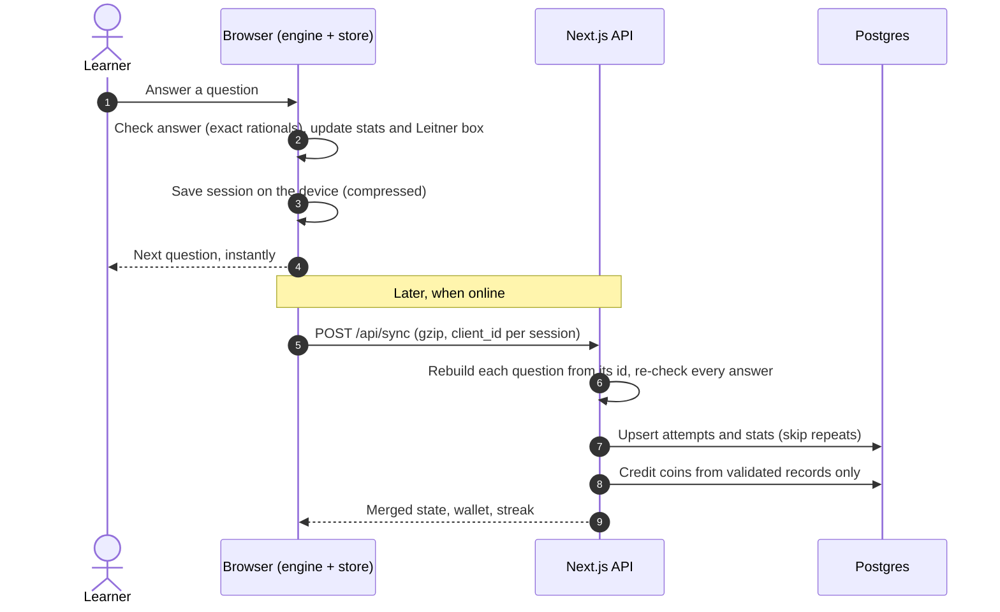
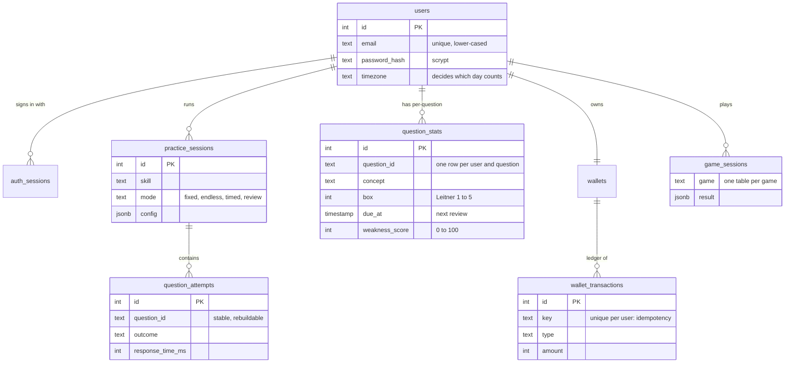

<p align="center">
  
</p>

<p align="center">
  
  
  
  
  
  
</p>

<p align="center">
  <b>An adaptive trainer for mental maths, working memory and logic.</b><br>
  It remembers every question you answer, finds what you find hardest, and brings it back right before you would forget it.
</p>

<p align="center">
  <a href="#features">Features</a> ·
  <a href="#architecture">Architecture</a> ·
  <a href="#tech-stack">Tech stack</a> ·
  <a href="#getting-started">Getting started</a> ·
  <a href="#project-structure">Structure</a> ·
  <a href="docs/REFERENCE.md">Full reference</a>
</p>

---

## Why Synapse

Most maths apps throw random questions at you. Synapse treats practice as a memory problem:

- **It knows your weak spots.** Every question has a stable id, and accuracy, speed and streaks are tracked per question, not per session.
- **It schedules reviews.** A Leitner spaced-repetition box system brings a question back after 1, 2, 4, 8 and 16 days, so a correct answer today is tested again later.
- **It never waits on the network.** Practice runs in your browser. Answers are saved on the device and synced in the background, so a train tunnel does not break a session.
- **It is more than drills.** Eight games train working memory, logic and speed, all feeding one coin economy and one daily streak.

## Features

### Eight skills

| Skill | What you practise |
| --- | --- |
| Addition | One to four digits, in the sizes you pick |
| Subtraction | One to four digits, with negative answers if you like |
| Multiplication | The 1 to 20 times tables |
| Division | Whole numbers, with whole or decimal answers |
| Percentages | Percent of a number, increases and decreases, conversions |
| Fractions | Simplify, fraction of a number, compare, convert |
| Squares | Squares, roots, cubes and cube roots |
| Exponents | Powers and the laws of exponents |

Every skill has fixed-length, endless and timed sessions, a focus mode (adaptive mix, weak questions only, or due reviews only), hints, skip, pause and an optional per-question time limit. After a miss you get a worked explanation, generated by deterministic rules rather than an AI service.

### Eight games

| Game | Trains |
| --- | --- |
| **MindSprint** | Flash arithmetic: numbers appear one at a time, you give the result |
| **Number Recall** | Memorising digits or number pairs and typing them back |
| **N-Back** | Working memory: spot position, colour or letter matches *n* flashes back |
| **Sudoku** | Logic, four difficulty levels, hints, resume |
| **2048** | Planning and pattern merging |
| **Queens** | Constraint logic over coloured regions |
| **Zip** | One continuous path through numbered checkpoints |
| **Patches** | Spatial logic: divide a grid into patches that match each clue. Every puzzle is generated and proved to have a single solution |

### The rest

- **Progress dashboard:** accuracy and speed per skill and exercise type, weakest concepts, upcoming reviews, Leitner box counts and trend charts.
- **Tables page:** the 20 × 20 multiplication heatmap and a separate 1 to 100 squares heatmap.
- **Streaks and profile:** a year-long practice calendar, current and longest streak, per-skill summary.
- **Coins and Streak Shields:** practice and games earn coins; coins buy shields that protect a streak on a missed day, and pay for hints. Every amount lives in one file (`src/features/rewards/lib/economy.ts`).
- **Accounts or guest mode:** sign up with email and password, or try everything without an account.
- **Installable and offline:** a PWA with a service worker, a manifest and maskable icons. After one online visit the app opens and runs with no connection.
- **Accessible:** keyboard-first, visible focus rings, light and dark themes, and `prefers-reduced-motion` respected.

## Architecture

Synapse is one Next.js app. The browser does the practice work; the server stores accounts, re-checks everything that is uploaded, and keeps the account's history.

### High-level design



### How an answer travels

Practice never blocks on the network. The device records the answer first; the server re-validates it later and ignores repeats, so a retry can never double-count.



### Data model



`game_sessions` stands for eight separate tables, one per game (`mindsprint_sessions`, `recall_sessions`, `sudoku_sessions`, `game2048_sessions`, `queens_sessions`, `zip_sessions`, `patches_sessions`, `nback_sessions`). The exact schema is in [`src/db/schema.ts`](src/db/schema.ts).

### Design decisions worth knowing

| Decision | Why |
| --- | --- |
| **Questions are rebuilt from ids** (`percentage:of:25:80`) | The server never trusts a prompt or an answer sent by the client. It rebuilds the question from its id and checks the answer itself. |
| **Exact rational arithmetic, no floats** | `0.5`, `0.50` and `.5` are equal and `0.49` is not. Answers are never marked right or wrong by rounding. |
| **Offline-first practice** | The engine runs in the browser, so answers are instant and survive a lost connection. The server is for durability and cross-device history. |
| **Idempotency keys everywhere** | Uploads, rewards and wallet charges carry keys built from what they pay for, so retries, re-renders and re-syncs pay once. |
| **Compressed on-device history** | Records leave out everything that follows from the question id, then lz-string compresses them. Measured 25 to 34 times smaller, so long histories stay far below the browser storage quota. |
| **Scrypt from `node:crypto`** | Password hashing without a native dependency, tuned to suit a serverless function. |
| **Optimistic proxy, strict routes** | `proxy.ts` only checks that a session cookie exists. Every page and route still verifies it against the database. |

The full folder rules and reasoning are in [`docs/ARCHITECTURE.md`](docs/ARCHITECTURE.md).

## Tech stack

| Layer | Technology |
| --- | --- |
| Framework | [Next.js 16](https://nextjs.org) (App Router, Turbopack) and [React 19](https://react.dev) |
| Language | TypeScript (strict) |
| Styling | [Tailwind CSS 4](https://tailwindcss.com), shadcn-style components on [Base UI](https://base-ui.com) and Radix, `tw-animate-css` |
| Theming | `next-themes` (light, dark, follows the system) |
| Icons | `lucide-react` |
| Charts | [Recharts](https://recharts.org) |
| Database | Postgres on [Neon](https://neon.tech), via the serverless driver |
| ORM and migrations | [Drizzle ORM](https://orm.drizzle.team) and drizzle-kit, plus idempotent SQL migrations |
| Auth | Email and password, scrypt hashing, database-backed session cookies, guest mode |
| Offline | Service worker, web app manifest, `lz-string` compression |
| Testing | Node's built-in test runner through `tsx`; the wallet SQL runs on in-process Postgres (PGlite) |
| Quality | ESLint 9, `tsc --noEmit` |

## Getting started

**You need:** Node.js 20 or newer, and a Postgres database (a free [Neon](https://neon.tech) project works well).

```bash
# 1. Install dependencies
npm install

# 2. Configure the database connection
cp .env.example .env.local        # then set DATABASE_URL

# 3. Create or upgrade the tables (idempotent, keeps existing data)
npm run db:migrate

# 4. Start the dev server
npm run dev
```

Open <http://localhost:3000>.

### Environment variables

| Variable | Description |
| --- | --- |
| `DATABASE_URL` | Postgres connection string used by the app and drizzle-kit |
| `LOG_LEVEL` | Optional: `debug`, `info`, `warn` or `error`. Defaults to `info` in production |

### Scripts

| Command | What it does |
| --- | --- |
| `npm run dev` | Start the development server |
| `npm run build` / `npm start` | Production build and server |
| `npm test` | Unit tests (no database needed) |
| `npm run lint` | ESLint |
| `npm run typecheck` | TypeScript compiler, no output |
| `npm run db:migrate` | Apply the SQL files in `src/db/migrations` |
| `npm run db:push` | Sync the schema to a new database |
| `npm run db:generate` | Generate SQL migrations from the schema |
| `npm run db:studio` | Browse data in Drizzle Studio |

## Project structure

```text
src/
  app/            Pages, layouts, API routes, manifest. Thin: fetch data, render a feature.
  features/       One folder per product area
    skills/         the eight drills: question ids, generators, pools, selection, spaced repetition
    games/          mindsprint, recall, sudoku, game2048, queens, zip, patches, nback, shared
    rewards/        coins, Streak Shields, paid hints
    offline/        device store, background sync, install prompt, service-worker client
    progress/       dashboard, charts, heatmaps
    auth/ settings/ home/
  components/     Shared UI (primitives, layout, form controls)
  lib/            Shared pure code: rational arithmetic, seedable RNG, logger, validation
  db/             Drizzle schema and SQL migrations
  proxy.ts        Session-cookie gate in front of pages and API routes
public/           Service worker, offline page, icons, brand art
docs/             ARCHITECTURE.md, REFERENCE.md, assets/
scripts/          migrate.ts, puzzle benchmarks
```

Each feature follows the same shape: `components/` for React, `lib/` for pure TypeScript with no React or database, and `server/` for anything that touches the database or cookies.

## Documentation

| Document | What is in it |
| --- | --- |
| [`docs/ARCHITECTURE.md`](docs/ARCHITECTURE.md) | Folder structure, conventions and the reasoning behind them |
| [`docs/REFERENCE.md`](docs/REFERENCE.md) | Every rule and formula: adaptive selection, the weakness score, answer validation, the coin economy, error logging, compression numbers, the API and each game |

## Testing

`npm test` runs the unit tests with no external database. They cover rational arithmetic, question id round-trips and malformed ids, answer validation, pool generation, spaced-repetition transitions, adaptive selection, the wallet (including concurrent purchases and duplicate keys) and the puzzle generators and solvers.

There is no committed end-to-end suite. The React components and the SQL that updates session totals are checked by hand and by `npm run build`, `npm run lint` and `npm run typecheck`.

## Brand

The name is **Synapse** and the logo is the half-circuit, half-spectrum brain in [`public/brand/`](public/brand). Each skill and game owns one accent colour, defined in one place: [`src/lib/accent.ts`](src/lib/accent.ts).
